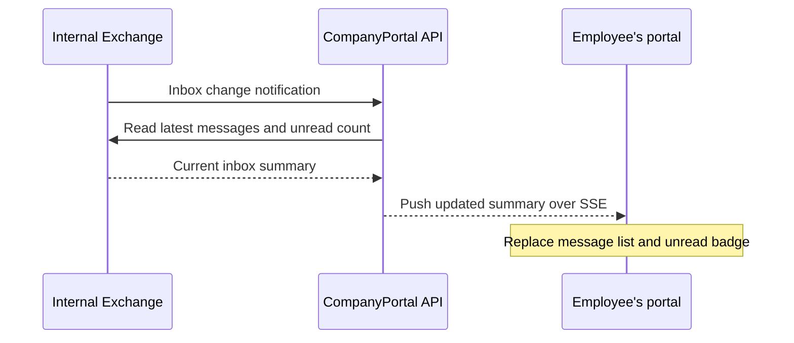

# How portal email works

This explains the current implementation as of 19 October 2026. The code is prepared and locally tested with simulated Exchange responses. Live Exchange access is currently disabled; real email will appear after the internal settings and permissions are configured and tested.

## What the employee sees

The email card shows the latest inbox messages, their senders, received times and read/unread state. The number beside the email icon is the total unread count in that employee's Inbox.

The list and count update without reloading the portal. The portal does not send emails or mark messages as read when it retrieves the list.

## When the portal opens

1. The browser connects to the API using the employee's Windows account, such as `COMPANY\employee1`.
2. The API checks that the account resolves to an active UserId in the external security database.
3. The API finds that account's explicitly configured mailbox address. It does not guess the address from the username or accept a mailbox chosen by the browser.
4. The API subscribes to Exchange notifications for that mailbox's Inbox.
5. It reads the latest messages and the whole Inbox's unread count, then sends them to the browser.
6. Two connections stay open: Exchange → API for mailbox events, and API → browser for live updates.

The Exchange connection uses EWS streaming notifications. The browser connection uses server-sent events (SSE), a built-in browser mechanism for receiving updates from a server. No SignalR package or cloud service is required by this implementation.

## When a new email arrives

Exchange reports the change; the API then retrieves the current summary and pushes it to the browser. There is no timer repeatedly checking the inbox for new mail. Read/unread changes, moves and deletions also trigger updates.

Updates are intended to arrive within seconds while connected. Actual timing still needs to be measured on the internal Exchange server; instantaneous delivery is not guaranteed.

## How the badge is counted

Suppose the Inbox contains **27 unread messages**, but the portal displays only the **latest 10 messages**. The badge still shows **27**.

If a new unread message arrives, it becomes 28. If the employee reads a message in Outlook, the count decreases when Exchange reports the change and the API retrieves the updated count. A new unread email is counted once, not added separately as both “new” and “unread.”

The current implementation counts the Inbox only, not every folder in the mailbox.

## What happens when the employee clicks

| Action | Result |
| --- | --- |
| Click **فتح البريد** | Open the configured internal Outlook Web inbox in a new tab, using `OutlookWebInboxUrl`. |
| Click a message with `OpenMode = Message` | Check that it still belongs to the employee's Inbox, then open that specific message in Outlook Web. |
| Click a message with `OpenMode = InboxSelected` | Perform the same check, then use an internally verified URL template intended to open the full inbox with that message selected. |

`Message` is the default. The full-inbox selection URL has not been verified against your Outlook Web installation, so its template is deliberately blank. The admin portal will offer this choice later; it is currently an appsettings choice.

Outlook Web handles its own sign-in/session. Opening a message there may mark it as read according to Outlook Web settings; the portal's list retrieval does not do that. If the message has moved out of the Inbox or been deleted, the old portal link will not open it.

## If a connection is interrupted

The portal clears the message rows, shows `—` for the unknown unread count, and displays a connection message. It retries the event-stream connection with a delay that grows from 5 to 30 seconds. After reconnecting, it creates a subscription and retrieves a fresh summary.

Small connection heartbeats and identity checks occur every 15 seconds. These do not read the inbox. Exchange streaming connections are renewed when they time out, and the browser stream reconnects after its ten-minute lifetime. Reconnection includes a fresh read to recover changes missed during an interruption.

Closing the portal disconnects its stream and attempts to remove its Exchange subscription. There is no worker watching that employee's mailbox after all their portal tabs disconnect.

## What to configure inside the air-gapped network

The settings are in the API's [appsettings.json](../Backend/CompanyPortal.Api/appsettings.json), under `Exchange`:

| Setting | What it means |
| --- | --- |
| `Enabled` | Currently `false`. Enable after completing the internal setup. |
| `EwsUrl` | Internal Exchange EWS HTTPS endpoint. |
| `OutlookWebUrl` | Internal Outlook Web base address, used for message links. |
| `OutlookWebInboxUrl` | Exact verified inbox address for **فتح البريد**, on the same Outlook Web origin. |
| `AccessMode` | Currently `Unconfigured`. The implemented live access mode is `ScopedServiceAccountImpersonation`, subject to Exchange administrator approval and provisioning. |
| `MailboxAddresses` | Explicit Windows-account → mailbox-address mappings, currently empty. |
| `LatestMessageCount` | Latest messages returned, default 10; allowed range 1–20. |
| `OpenMode` | `Message` or `InboxSelected`. |
| `InboxSelectedUrlTemplate` | Verified full-inbox selection URL template containing `{itemId}`; currently empty. |

The API runs under a Windows service/IIS identity. An Exchange administrator must authorize that identity to access only the intended mailboxes. Employee Windows sign-in to the portal does not automatically grant the API access to their mailbox. Setting an access-mode name in JSON does not grant Exchange permissions.

The API server must also reach Exchange through internal DNS/networking and trust its HTTPS certificate. IIS and any proxy must allow the long-lived connections to stream without buffering. No public internet connection is needed for the runtime design.

## What is complete and what remains

Implemented and locally checked: protocol/event handling with simulated Exchange responses, unread counting, frontend updates, account isolation checks, link configuration, reconnection, and the browser's unavailable state. No actual Exchange mailbox has been accessed by these tests.

Still required internally: real mailbox authentication, service-account scope, certificates, end-to-end live updates and timing, the inbox/message URLs, and the optional full-inbox selection template. Changing appsettings supplies the application configuration; the Exchange/IIS permissions and infrastructure must be set up separately.

See [EMAIL.md](EMAIL.md) for the detailed setup, endpoints, limits, test commands and protocol references.
