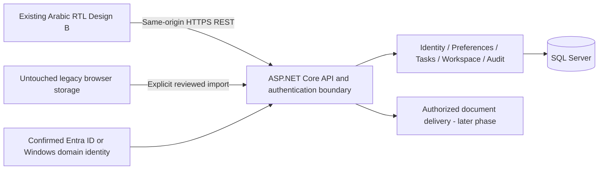

# Clerio — Enterprise Architecture Plan, Phase 1

Assessment date: 15 October 2026. Revised after the user's authorized removal of Design C. Scope: the current working-tree version of Design B, now the sole portal design, and its supporting profile page. This is an assessment and implementation proposal, not an implemented backend or a production readiness certification.

The recommended direction is a modular ASP.NET Core application with a REST API and SQL Server, retaining the existing HTML/CSS/Vanilla JavaScript interface. Identity infrastructure must be confirmed before selecting the authentication implementation. Preserve the original browser data and introduce account-bound persistence incrementally.

## 1. Current architecture summary

### Evidence and boundaries

`AGENTS.md` and `PROJECT_REFERENCE.md` were read before the assessment. The implementation was checked against the reference because parts of the reference describe historical layouts. Unrelated working-tree changes were preserved. The subsequent removal of Design C was explicitly requested by the user and is recorded below; it supersedes the original assessment-only restriction for that cleanup.

The focused source review covered `package.json`, `package-lock.json`, `vite.config.js`, the entry pages, `user-profile.html`, Design B's directly loaded scripts/styles, relevant selectors/events, and persistence/network call sites. Before removing C, its references were compared with the retained project to identify exclusive files. Actual browser storage values and enterprise infrastructure were not inspected.

### Observed implementation

- `dist/` contains editable source. It must never be treated as a disposable build output.
- `package.json` declares Vite **8.0.13** as its only direct development dependency. Its only script is `dev`: `vite dist --config vite.config.js`. No application build or test script is declared.
- `vite.config.js` binds development to `127.0.0.1:5173` with `strictPort`. A middleware serves `tools/layout-review.html` at `/__review`. This is a layout helper, not a backend API.
- `dist/index.html` redirects to `design-b.html`; the JavaScript redirect preserves the query and fragment.
- `dist/design-b.html` is Arabic, RTL, and uses the local GT America Arabic font. It loads 19 local CSS files and 19 local JavaScript files. Browser scripts use classic ordered script loading and DOM manipulation, rather than application ES-module imports. The package-level ESM setting does not change those browser script semantics.
- Design B is the only remaining portal design and exposes themes **2, 3, and 4**. Its scripts retain inactive legacy theme metadata filtered by the available panels/buttons; this cleanup does not restore themes 1 or 5 or change B's JavaScript.
- State is distributed across DOM elements, script-local variables, `localStorage`, custom events, and observers. There is no single application store or authenticated data layer.
- No ASP.NET application, SQL persistence, enterprise sign-in, server authorization, or backend audit trail was identified in the assessed application architecture.
- The magazine reader fetches a local JSON manifest. This is a static content request, not evidence of a business API. System launch buttons, employee details, request counters, correspondence, and status indicators currently represent prototype content or interactions.

### Network boundary

Most resources are local. Design B references external Iconsax CSS at `https://iconsax.gitlab.io/i/icons.css`. News data includes external imagery, including Al Roya resources, and outbound source links. Source links containing `/rss` do not establish a live RSS integration: the news metadata is supplied by JavaScript. Local file previews use browser object URLs and do not upload files to a server. Font and SVG resources are primarily local; an SVG namespace URI is not itself a network request.

The localhost address is not a public deployment. A production frontend packaging and hosting process remains to be designed; Vite's development server must not become the production intranet host.

## 2. Module inventory

Paths below are relative to the repository root. CSS responsibilities follow the current entry order, not a proposal to reorganize files.

| Module | Existing files | Current responsibility and persistence |
| --- | --- | --- |
| Entry and base shell | `dist/index.html`, `dist/design-b.html`, `dist/design-b.css`, `dist/design-b-header.css`, `dist/design-b-layout.css` | Entry redirect, Arabic RTL page structure, header, profile shell, responsive layout; employee/attendance examples are not identity records. |
| Core interactions | `dist/design-b.js` | Global search, phone directory search, toast helpers, notification rendering, workspace view. Reads personal tasks independently of the planner; stores recent searches and view preference. |
| Organization status | `dist/design-b-status.js` | Prototype status interaction; no verified operational status service or persistent institutional state. |
| Personal area, themes, calendar and tasks | `dist/design-b-intro.js`, `dist/design-b-planner.css`, `dist/design-b-calendar-integrated.css` | Theme selection; date rendering using `Intl`; planner relocation; task create/edit/delete/complete; legacy note conversion; conditional demo seeding. Main business-data persistence hotspot. |
| Theme presentation | `dist/design-b-themes.css`, `dist/design-b-palette.css`, `dist/design-b-formal-theme.css`, `dist/design-b-majestic-theme.css`, `dist/design-b-national-theme.css` | Theme styles and national occasion artwork. Preserve B's themes 2/3/4 and current assets. |
| Personal/calendar placement | `dist/design-b-floating-calendar.css`, `dist/design-b-header-scroll.css`, `dist/design-b-personal-carousel.js` | Floating calendar/header styles. Despite its historical filename, the personal-carousel script currently supplies shared arrow styling rather than the removed personal carousel behavior. |
| Workspace cards and pagination | `dist/design-b-workspace.css`, `dist/design-b-widget-layout.js` | Layout, card pagination, DOM-derived badges, mutation/resize observation. Counts are not enterprise queries. |
| System catalog and pinning | `dist/design-b-systems.js`, `dist/design-b-systems.css` | Catalog derived from HTML, search/filter, detail sheets and pinned cards. Defaults: library, inbox, requests, services. Pinning is personalization, not access permission. |
| Workspace groups and order | `dist/design-b-workspace-groups.js`, `dist/design-b-workspace-order.js` | User-created groups, ordering and content concealment, saved locally. Concealment/blur is a display preference, not data protection. |
| Electronic service forms | `dist/design-b-electronic-services.js` | Locally records report/initiative/assignment requests. Success is local persistence, not institutional submission or workflow acceptance. |
| Notices | `dist/design-b-notice-strip.js`, `dist/design-b-floating-notices.js`, `dist/design-b-notice-strip.css` | Notice details, floating notices, hide/restore behavior. Hidden source markup supplies content; removal would break consumers. Dismissal is not a durable server read receipt. |
| Editorial and media | `dist/design-b-editorial.js`, `dist/design-b-editorial.css` | Static stories, saved article references, media viewers and local video preview. Saved references persist; selected media files do not. |
| Monthly magazine | `dist/design-b-magazine.js` and local manifest/page assets | Fetches local page manifest; reads an issue label preference. Added local issues/object URLs are held in memory and cleaned up, not durably uploaded. |
| Theme 4 news | `dist/design-b-majestic-news.js` | Static news metadata and theme-related presentation/timers; some external image/source URLs. |
| Library and safety | `dist/design-b-library.js`, `dist/design-b-safety.js`, `dist/design-b-library.css` | Library/booklet interfaces and safety content; placeholder document entries are not an authenticated document repository. |
| Policies and documents | `dist/design-b-policies-sheet.js`, `dist/design-b-documents-sheet.js`, `dist/design-b-documents-sheet.css` | Dialogs, document categories and generated sample titles. Existing policy text is illustrative, not approved enterprise policy. |
| Section navigation | `dist/design-b-section-nav.js`, `dist/design-b-section-nav.css` | Section navigation and active-section behavior. |
| Profile page | `dist/user-profile.html` | Static employee profile and attendance information; shares base/header CSS. No verified HR integration. |

`dist/design-b-typography.css` exists but is not a directly loaded Design B stylesheet. Do not rely on changing it to affect the approved page.

## 3. Data persistence inventory

### Observed localStorage keys

These are source-level read/write contracts, **not a dump of actual user data**. JSON is used unless explicitly stated otherwise. All keys are origin-scoped, not employee-scoped. Browser profiles/devices may therefore contain data whose ownership cannot be established from the records alone.

| Exact key | Reader/writer | Shape and classification | Recommended disposition |
| --- | --- | --- | --- |
| `clerio-opening-theme` | `design-b-intro.js`, read/write | JSON string theme ID; genuine preference. The implementation can normalize an unavailable theme on initialization. | Account preference scoped to interface profile; B allowlist 2/3/4. Preserve original raw value during migration. |
| `clerio-personal-tasks` | `design-b-intro.js`, read/write; `design-b.js`, read | Array of task-like records; mixed user data, demo data and a user-requested seeded occasion. | Highest-priority business-data import, after ownership confirmation and preview. |
| `clerio-business-notes` | `design-b-intro.js`, read/write | Object mapping date to note text; legacy user notes can coexist with default sample text. | Preserve; reconcile against copied tasks before import. Do not discard the original notes. |
| `clerio-business-demo-date` | `design-b-intro.js`, read/write | JSON date string anchoring examples; initialized if invalid/missing. | Local seed metadata, not a business record. |
| `clerio-national-day-2026-10-15-added` | `design-b-intro.js`, read/write | Boolean initialization marker for a requested occasion. | Preserve locally; not a user preference or proof of an official holiday. |
| `clerio-floating-calendar-examples-v1` | `design-b-intro.js`, read/write | Boolean sample-seed marker. | Preserve locally; exclude from business import. |
| `clerio-business-examples-v1` | `design-b-intro.js`, read/write | Boolean marker for conditional sample tasks/notes. | Preserve locally; exclude from business import. |
| `clerio-business-notes-merged-v1` | `design-b-intro.js`, read/write | Boolean marker for legacy notes copied into task records. | Migration evidence only; do not treat it as proof every note was correctly copied. |
| `clerio-search-recents-v1` | `design-b.js`, read/write | `{all: string[], phone: string[]}`; up to six retained entries per mode; loader limits strings to 80 characters. Actual user search history. | Keep browser-local by default; do not silently upload potentially sensitive queries. |
| `clerio-workspace-view-v1` | `design-b.js`, read/write | **Raw string**, `grid` or `horizontal`. | Optional account preference; do not JSON-decode as an object. |
| `clerio-design-b-pinned-systems-v1` | `design-b-systems.js`, read/write | Array of allowlisted catalog IDs. Legacy values remain unchanged after C's removal. | Account preference, validated against an authorized catalog. Pinning never grants access. |
| `clerio-workspace-groups-v1` | `design-b-workspace-groups.js`, read/write | Array of `{id, name, systems}`; generated group IDs, trimmed names capped at 60, deduplicated catalog IDs. User-generated configuration. | Import groups with stable mappings and preserved names/membership. |
| `clerio-workspace-card-order-v1` | `design-b-workspace-order.js`, read/write | Array of card IDs, including group IDs. | Import after pin/group mapping; retain references that can be reconciled. |
| `clerio-workspace-concealed-cards-v1` | `design-b-workspace-order.js`, read/write | Array of concealed card IDs. | Preference only; protect underlying API data independently. |
| `clerio-editorial-saved` | `design-b-editorial.js`, read/write | Array of saved article IDs. User bookmarks pointing to prototype content. | Import resolvable references; retain unresolved IDs for review rather than inventing articles. |
| `clerio-electronic-service-requests-v1` | `design-b-electronic-services.js`, read/write | Array of `{id, type, category, message, createdAt}`; UUID, report/initiative/assignment, text and ISO timestamp. User-generated data. | Import as legacy drafts or records awaiting review; never claim they were officially submitted. |
| `clerio-monthly-magazine-issue-number` | `design-b-magazine.js`, read | **Raw string** used for an issue display label. No writer identified in the inspected code. | Legacy/unknown-origin presentation metadata; not evidence of a published issue or uploaded file. |

### Task contract and provenance

The planner uses `title`, `date` (`YYYY-MM-DD`), optional `time` (`HH:mm` or empty), `type`, `body`, and `done`. Observed types are `task`, `meeting`, `call`, `delivery`, `note`, and `event`. Records may also contain `demo`, `id`, or `legacyNoteDate`.

Ordinary user-created tasks do not receive stable IDs, employee ownership, creation timestamps, or revision numbers. Some seeded records have IDs. An importer cannot safely assume every task has an ID or deduplicate tasks by title/date: identical tasks may be intentional.

The current loader validates/coerces records, including substituting today's date for an invalid date. Export and import previews must start from an untouched raw storage snapshot, not just the already-normalized in-memory task array. Flag malformed records for review and retain them in the backup.

### Demonstration data versus user data

- Hardcoded employees, directory entries, attendance, inbox messages, request summaries, news, notices, policies, systems and document catalogs are prototype data. They must not populate production employee, correspondence or workflow tables automatically.
- Conditional planner seeding adds examples marked `demo: true`. Example initialization order affects whether all sample sets are added; source presence does not prove a specific browser contains them.
- Default legacy note text may lack a `demo` marker. Legacy notes copied into tasks use `legacyNoteDate`, so importing both stores without reconciliation can duplicate content.
- The requested National Day item has ID `national-day-2026-10-15`, date `2026-10-15`, and `demo: false`, despite being inserted by initialization code. It is user-requested content, not an ordinary disposable sample. Other floating-calendar examples have different dates and `demo: true`.
- A hardcoded occasion also uses an `official` flag. Neither that flag nor the prototype's date should authorize enterprise-wide publication. The artwork references 20 November while the requested calendar insertion uses 15 October; an authorized content owner must resolve the intended meaning/date before any official calendar import. No legal holiday verification was performed.
- Editing a sample can change `demo` to false. These flags are hints, not reliable proof of authorship or authority.

A migration preview should group records as confirmed user content, likely examples, ambiguous legacy content, and malformed/unresolved content. Nothing is silently deleted. Explicitly confirmed records are imported; excluded records remain in the original snapshot.

### State that is not durably persisted

Notice dismissal, many open/closed dialogs, paging/filter selections, DOM message states, library interactions, status selections and current media previews are session/in-memory behavior unless backed by a listed key. Local magazine additions and video object URLs do not survive as enterprise uploads. No application IndexedDB, sessionStorage or server-backed persistence was identified in the assessed sources; actual browser state was not inspected.

## 4. Dependency and shared-file map

### Design B loading order

CSS order matters: later files can override earlier shared rules. The current order is:

```text
design-b.css → header → workspace → editorial → section-nav → systems
→ notice-strip → themes → palette → planner → layout → calendar-integrated
→ documents-sheet → formal-theme → majestic-theme → library → national-theme
→ floating-calendar → header-scroll
```

Every shortened stylesheet name above has the `design-b-` prefix and `.css` suffix.

The classic scripts run in this order:

```text
policies-sheet → documents-sheet → status → design-b.js → notice-strip
→ editorial → magazine → library → safety → intro → majestic-news
→ personal-carousel → section-nav → floating-notices → systems
→ workspace-groups → workspace-order → electronic-services → widget-layout
```

Every shortened script name has the `design-b-` prefix and `.js` suffix. Do not convert these to unordered asynchronous loading during initial backend integration.

### Retained dependencies and Design C removal

All 19 local CSS and 19 local JavaScript entry dependencies of B are retained. `user-profile.html` shares `design-b.css` and `design-b-header.css`; preserve this remaining cross-page dependency. Images/fonts may also serve multiple B modules and the profile page.

Before removal, C reused 11 of B's CSS files and 8 of B's scripts. Those are B dependencies and remain intact. The following ten C-exclusive files were removed after checking references in the retained project:

```text
dist/design-c.html
dist/design-c-theme.css
design-c-preview.png
dist/assets/logo-light.avif
dist/assets/author-ahmed.svg
dist/assets/author-khalid.svg
dist/assets/tech-workflow.svg
dist/assets/tech-knowledge.svg
dist/assets/tech-lab.svg
dist/assets/tech-dashboard.svg
```

No B HTML, JavaScript, stylesheet, localStorage key or value was changed by this cleanup. The root redirect still targets B. The project instructions/reference and README were updated to describe B as the sole remaining design.

### Runtime contracts and regression points

| Contract | Producer/consumer relationship | Integration consequence |
| --- | --- | --- |
| Global helpers | `design-b.js` defines helpers including `showToast`, `closeSearch`, `updateWorkspaceNavigation`; other modules reference helpers conditionally. | Preserve availability/order when adding data hydration. |
| `clerio:theme-change` | Intro dispatches; editorial/theme news react. | Hydrating the preference must trigger the existing theme flow, with B's allowlist. |
| `workspace:cards-changed` | Groups dispatch on `#workspace-cards`; system/order/layout code responds. | Hydrate groups and pins before final ordering/counts; notify consumers once state is coherent. |
| `sc:reveal` | Core search dispatches; notices/policies/systems/layout reveal or retarget matching content. | Search authorization must precede results; hiding a DOM node does not secure its content. |
| `notices:show-all` | Floating notices request the notice-strip dialog. | Retain the hidden notice source markup and existing disclosure behavior. |
| Planner relocation | Intro moves shared planner/composer elements into current theme/floating calendar. | Do not assume fixed parent nodes or insert a second planner. |
| Mutation/resize observers | Widget layout observes cards and relevant attributes. | Async rendering can create stale counts or repeated initialization unless hydration is coordinated. |
| Direct storage consumers | Core notifications read tasks separately from intro. | Replacing only the planner store leaves notifications using legacy, potentially wrong-account data. |
| DOM-built catalog/search | Catalogs, search indexes and badges derive from existing markup. | Hydration must refresh derived indexes and must not retain unauthorized or previous-account entries. |

Legacy storage can still contain preferences created while other designs existed. Keep those values intact and validate them at the API boundary. Future changes need B and profile-page coverage where files are shared; C is removed and is no longer a regression target. Preserve current source deletions and do not restore themes 1 or 5 to B.

## 5. Proposed backend architecture

### Application shape

Use a **modular monolith**: one deployable ASP.NET Core application, one SQL Server database initially, and explicit module ownership. This avoids premature distributed services while allowing later extraction if measured operational needs justify it.

Use .NET 10 LTS, at the supported servicing patch approved when implementation starts. The Microsoft support policy lists .NET 10 support through November 2028; .NET 8/9 have much shorter remaining support at this assessment date. This is a proposed baseline, not an installed or validated runtime. [Microsoft .NET support policy](https://dotnet.microsoft.com/en-us/platform/support/policy/dotnet-core)



Suggested new directories, **not created in Phase 1**:

```text
server/Clerio.Api/              HTTP endpoints, auth middleware, composition
server/Clerio.Application/      Use cases, policies, validation, interfaces
server/Clerio.Domain/           Entities, invariants, module contracts
server/Clerio.Infrastructure/   EF Core SQL Server, identity adapters, audit persistence
server/Clerio.Contracts/        Versioned request/response models
tests/                         Backend unit and integration tests
```

Keep business boundaries explicit: Identity/Organization, Authorization, Personal Work, Personalization/Workspace, Legacy Import and Audit. Documents, Content, Correspondence and Institutional Requests are later modules with their own source-of-truth decisions. Do not turn every displayed card into a separate microservice or database.

Use EF Core with a compatible supported SQL Server provider; exact package versions and SQL Server edition/version require infrastructure approval. No dependency is installed by this assessment. Avoid adding a generic repository layer or messaging infrastructure without a concrete use case.

### Frontend preservation and contracts

Introduce a small B-scoped API client and feature-specific repository adapters in a later implementation phase. Keep existing markup, CSS, RTL, local fonts, themes, events and user interactions. Centralize task reads so the planner and notifications consume the same account-bound repository. A local-mode adapter supports the existing prototype during rollout; authenticated mode must not silently fall back to unowned legacy records.

Initial contract candidates:

| Endpoint | Purpose and boundary |
| --- | --- |
| `GET /api/v1/me` | Authenticated employee identity and permitted capabilities; no hardcoded profile fallback. |
| `GET /api/v1/me/preferences` | Current employee's validated preferences, separated by client profile such as `design-b`. |
| `PUT /api/v1/me/preferences/{key}` | Idempotent preference update with version checking and an allowlisted key/schema. |
| `GET/POST /api/v1/me/tasks` | Bounded task query/create; owner comes from the server identity. |
| `PATCH/DELETE /api/v1/me/tasks/{id}` | Ownership/resource authorization and concurrency checking. |
| `POST /api/v1/me/legacy-import/preview` | Validates a snapshot without changing business data; returns proposed mappings/conflicts. |
| `POST /api/v1/me/legacy-import/commit` | Commits an approved preview with idempotency and transactional audit. |

Use consistent problem responses, bounded request sizes/paging, server validation, correlation IDs and explicit versions. Use `ETag`/`If-Match` for updates and return a precondition failure on stale versions; never silently overwrite another session. An idempotency key must be bound to employee, operation and payload digest; reject reuse with different content. Do not automatically retry unsafe writes without that protection.

Host frontend and API under one HTTPS origin in production. Publish a **copy** of approved frontend assets; never clean or overwrite source `dist/`. Development can later proxy `/api` through Vite after a separate approved change. Production has no Vite dependency and does not expose `/__review`. Protect intranet HTML and confidential resources at the hosting/auth boundary; placing files under a static directory does not automatically enforce endpoint authorization.

## 6. Initial database design

### Conventions

- Assume one organization for this initial proposal. If multi-tenancy is required, decide it before schema implementation and include tenant ownership in keys, constraints and authorization throughout.
- Business entity IDs: `uniqueidentifier`. All Arabic text: bounded `nvarchar`; long text/JSON: `nvarchar(max)` with size validation. Permission codes should be stable identifiers, separate from translated labels.
- Instants: UTC `datetime2(7)` with server defaults. Task calendar dates: SQL `date`; optional wall-clock time: `time(0)` plus a defined time-zone policy. Preserve date-only/all-day semantics; do not shift legacy dates through UTC conversion. Confirm organization time zone rather than infer it from a developer's machine.
- Mutable aggregates: SQL `rowversion`, exposed as an opaque version token. A rowversion is not a timestamp. EF Core supports SQL Server rowversion-based optimistic concurrency. [Microsoft EF Core concurrency guidance](https://learn.microsoft.com/en-us/ef/core/saving/concurrency)
- Define foreign keys, controlled deletion rules and indexes in migrations. Do not cascade-delete employees' work or audit history when an identity is deactivated.

### Core tables

| Table | Initial columns and constraints | Main indexes/relationships |
| --- | --- | --- |
| `Departments` | `Id`, `Code`, `NameAr`, `ParentDepartmentId?`, `IsActive`, UTC timestamps, `RowVersion`. Unique `Code`. Prevent hierarchy cycles in validated use cases. | Self FK; parent index. |
| `Employees` | `Id`, `EmployeeNumber?`, `DisplayNameAr`, `Email?`, `JobTitleAr?`, `DepartmentId?`, `ManagerEmployeeId?`, `IsActive`, UTC timestamps, `RowVersion`. HR identifier, if present, is distinct from a sign-in email. | Department/manager FKs; unique filtered employee-number index; department/active index. |
| `EmployeeIdentities` | `Id`, `EmployeeId`, `Provider`, `Issuer`, `Subject`, `LastSeenAtUtc?`. Stable external identity mapping; bounded provider-specific fields. | Employee FK; unique `(Provider, Issuer, Subject)`. Entra tenant/object identifiers or validated Windows domain SID; email is not the ownership key. |
| `Roles` | `Id`, `Code`, `NameAr`, `IsSystem`, `IsActive`, timestamps, `RowVersion`. | Unique `Code`. |
| `Permissions` | `Id`, `Code`, `DescriptionAr`. Initial codes might include `tasks.read.self`, `tasks.write.self`, `organization.read`, `preferences.write.self`, `authorization.manage`. | Unique `Code`; version-controlled permission definitions. |
| `RolePermissions` | `RoleId`, `PermissionId`. | Composite PK; both FKs. |
| `EmployeeRoleAssignments` | `Id`, `EmployeeId`, `RoleId`, `ScopeKind`, `DepartmentId?`, `GrantedByEmployeeId`, `GrantedAtUtc`, `ExpiresAtUtc?`, `RowVersion`. Scope: Self, Department or Organization. Check department is supplied only for department scope. | Employee/role/department/grantor FKs; filtered unique indexes preventing duplicate scope assignments; employee/expiry index. |
| `Tasks` | `Id`, `OwnerEmployeeId`, `CreatedByEmployeeId`, `Title`, `Body?`, `Type`, `DueDate`, `DueTime?`, `TimeZoneId?`, `IsCompleted`, `CompletedAtUtc?`, `Origin`, `LegacyImportItemId?`, UTC creation/update fields, `DeletedAtUtc?`, `RowVersion`. Validate the six observed task types and field lengths. | Owner/date/completion index; owner/deleted index; employee/import FKs. Legacy completion time may remain unknown rather than be fabricated. |
| `EmployeePreferences` | `Id`, `EmployeeId`, `ClientProfile`, `PreferenceKey`, `ValueJson`, `SchemaVersion`, `UpdatedAtUtc`, `RowVersion`. `ISJSON` check plus application schema validation. | Unique `(EmployeeId, ClientProfile, PreferenceKey)`; employee FK. B theme validation: 2/3/4. |
| `AuditLogs` | `Id`, `OccurredAtUtc`, `ActorEmployeeId?`, `Action`, `ResourceType`, `ResourceId?`, `Outcome`, `CorrelationId`, bounded/redacted `MetadataJson?`. Include failed authorization and administrative change events without recording secrets. | Time, actor/time and resource/time indexes. Append-only application contract; restricted retention/purge role. |

Roles grant permissions; scoped assignments constrain where they apply. Initial ordinary employees receive only approved self-service capabilities. Do not grant department visibility merely because an employee belongs to that department or has a manager job title.

### Import and supporting tables

| Table | Purpose and minimum design |
| --- | --- |
| `LegacyImportBatches` | `Id`, authenticated `EmployeeId`, source/profile, snapshot digest, preview schema version, status, creation/commit timestamps and counts. Unique employee/source/digest prevents recommitting the same snapshot. Do not require storing all raw content on the server; retain a protected original export with the user and apply a separately approved retention policy if server snapshots are necessary. |
| `LegacyImportItems` | `Id`, `BatchId`, source key, source position/reference, content digest, classification, decision, destination type/ID and outcome. Unique batch/source position. Preserve duplicates intentionally present in one snapshot; mapping must not rely on title/date alone. |
| `WorkspaceGroups` | `Id`, `EmployeeId`, `NameAr`, timestamps, `RowVersion`; map imported `group-*` IDs through import records. |
| `WorkspaceGroupSystems` | Composite `(GroupId, SystemCode)` plus `SortOrder`; validate membership against an authorized catalog. Catalog codes identify integrations, not permission grants. |
| `SavedContentReferences` | `Id`, `EmployeeId`, content type, stable content reference, saved timestamp; unique employee/type/reference. Keep unresolved legacy references separate from authoritative content records. |
| `ServiceRequestDrafts` | `Id`, `EmployeeId`, type/category/message, `LegacyClientId?`, source creation timestamp, import provenance, review state, UTC timestamps and `RowVersion`. Legacy local saves enter as drafts/awaiting review. Official submission becomes a later transaction with its own workflow and acknowledgement. |
| `CalendarOccasions` — later | Authorized organization/department scope, title, date, approval state, publisher and timestamps. Do not create authoritative occasions from a client-supplied `official` boolean. Personal `event` tasks remain personal work. |

Pins, view, order and concealment can initially remain versioned preference JSON rather than require separate relational tables. Group names/membership merit explicit tables because they are user-authored and referenced by order lists. Import groups first, then rewrite order references through the mapping without deleting unresolved original values.

Employee/department synchronization ownership, historical transfers, role hierarchy, retention and future task assignment beyond self-owned work require product/infrastructure decisions. They are not silently assumed features of this schema.

## 7. Authentication and authorization design

### Infrastructure decision required

Confirm the identity authority, tenant/domain, device estate, IIS/reverse-proxy topology, DNS/TLS, account provisioning, deprovisioning, MFA expectations and SQL hosting. Select one supported primary sign-in mode; do not build a custom password database to bridge uncertainty.

**Option A — Microsoft Entra ID:** use server-side OpenID Connect authorization code flow with PKCE through the supported Microsoft identity stack. Keep credentials and any downstream tokens on the server. The browser receives an application session cookie marked Secure/HttpOnly with a tested SameSite policy; it does not store access or refresh tokens in `localStorage`. Use stable tenant/object identity mapping and enforce approved tenant access. Conditional Access/MFA remain organization-managed policies, not presumed portal capabilities. [Microsoft authorization code flow](https://learn.microsoft.com/en-us/entra/identity-platform/v2-oauth2-auth-code-flow)

**Option B — Active Directory/Windows:** if confirmed suitable for the domain-joined intranet, use validated Windows authentication at IIS or a supported Negotiate hosting boundary. Confirm Kerberos/SPNs, browser policies, proxy behavior and service identity. Do not accept arbitrary identity headers or collect AD passwords in a portal form. Negotiate behind a proxy has connection-affinity constraints that must be addressed in the chosen topology. [Microsoft Windows authentication guidance](https://learn.microsoft.com/en-us/aspnet/core/security/authentication/windowsauth?view=aspnetcore-10.0)

Both options map the verified principal to an active `Employee` through `EmployeeIdentities`. Resolve unrecognized/disabled identities according to an approved provisioning policy; never attach old browser tasks to an account based only on a matching display name/email.

### Server enforcement

- Require authentication by default. `/api` returns structured 401/403 responses instead of an HTML login page when appropriate; interactive sign-in uses separate routes.
- Enforce permission policies plus resource ownership/scope on every endpoint, including reads, search results, counts, downloads and import previews. Client-provided employee IDs cannot select an owner. Resource checks belong on the server, including object-level access checks. [Microsoft resource-based authorization](https://learn.microsoft.com/en-us/aspnet/core/security/authorization/resource-based?view=aspnetcore-10.0)
- Use narrowly scoped roles. Administrative grants/revocations require an administrative permission and audit entry; users cannot self-assign roles. Directory group-to-role mappings must be explicit and controlled.
- Revalidate active identity/permissions with a defined revocation freshness policy; long-lived stale claims must not preserve removed access.
- Cookie or ambient Windows credentials require CSRF protection for state-changing requests. Use antiforgery tokens/headers and validated origins; SameSite and CORS alone are not sufficient. [Microsoft antiforgery guidance](https://learn.microsoft.com/en-us/aspnet/core/security/anti-request-forgery?view=aspnetcore-10.0)
- Keep APIs same-origin by default. If separate origins become necessary, allow only approved exact origins and credential policies.
- Persist and protect ASP.NET Core Data Protection keys for restarts/multiple instances. Protect confidential-client credentials outside source control. Logout clears only new account-scoped runtime/cache state; it must not delete untouched legacy keys.

Existing pinning, hidden cards, blur, system availability indicators and profile markup are not authorization controls.

## 8. Incremental migration strategy

Each step has a release gate and can be stopped without deleting legacy data.

| Step | Work | Exit gate |
| --- | --- | --- |
| 0. Confirm decisions and capture baseline | Approve identity/hosting/SQL decisions, account provisioning, employee ownership source and retention; document API/data contracts. Provide an untouched raw browser export before any frontend persistence switch. | Infrastructure owner signs decisions; exports are restorable; module ownership and feature-flag boundaries are explicit. |
| 1. Isolated authenticated foundation | New server project, identity mapping, default authorization, `/api/v1/me`, operational health endpoints, structured errors and audit foundation. No frontend persistence changes. | Authenticated/unauthenticated/disabled-account paths tested with the selected provider; no prototype identity fallback. |
| 2. Read-only frontend identity | Opt-in B API adapter renders confirmed identity using existing UI. Keep prototype mode isolated from authenticated mode. | No previous-account content flash; existing B/profile layout preserved; clear service failure behavior. |
| 3. Preferences | Migrate a small allowlist such as theme/view after preview and account confirmation. Keep search history local. | Conflict handling, B theme allowlist, sign-out/account-switch and two-session tests pass. |
| 4. Personal work | Implement task CRUD and import preview/commit; change both planner and notification reads to the same repository. | Ownership, dates/time, duplicates, legacy notes, concurrency, error recovery and import idempotency pass. |
| 5. Workspace and local request records | Import groups, pins/order/concealment and bookmarks; import service forms as drafts. | Valid catalog mappings, unresolved-reference reporting and no false claim of institutional submission. |
| 6. Authoritative enterprise content | Separately integrate HR, correspondence, requests, document storage, official notices/calendar and news as approved. | Each source-of-truth contract, permissions and audit behavior are approved and tested. |
| 7. Production rollout | Controlled cohort, operational monitoring and restore rehearsal, then progressive rollout. | Support, rollback, backups, security gates and owner acceptance are documented. |

### Safe import procedure

1. Read original key/value strings without normalizing or writing them. Export a versioned snapshot with origin, capture time and digest. Do not overwrite existing keys, reset flags or seed new records as part of export.
2. Show the signed-in employee and explain that this browser's legacy records lack ownership. Require confirmation of ownership/selection before importing business data, especially on shared computers. Do not assume every record belongs to the first person who signs in.
3. Preview raw parsing, malformed data, sample classification, note/task overlap and unresolved references. Preserve every source position and exact text. Never auto-delete `demo` records or auto-import ambiguous notes.
4. Seal the approved snapshot/decisions. Identify records without IDs using batch/source position and digest, not title/date. A changed snapshot requires reconciliation; it must not automatically replay previously imported work as new tasks.
5. Commit an employee-bound, idempotent transaction with item mappings and audit. Partial failures must be recoverable without duplicating records; preserve the original snapshot in all cases.
6. Verify counts, selected content, completion and date semantics; provide an import receipt. Only switch the feature to API reads/writes after success and acceptance. Keep original localStorage values unchanged.

An HTTPS production origin cannot read `http://127.0.0.1:5173` storage. A different browser, profile or `localhost` hostname is also a different storage context. Migration requires explicit export/import from the original origin; deployment cannot simply discover those values server-side.

Once authenticated mode is enabled, do not show legacy unowned tasks while identity is loading and do not silently write to legacy storage when the API fails. Surface a recoverable error in the existing flow. Any new cache must include employee identity and schema version and be cleared from memory on account switch. Never clear all localStorage.

Rollback means disabling the affected integration and preserving both server records and original snapshots. It must not overwrite newer server work with an old browser array. Reverting to legacy local editing after server cutover requires an explicit reconciliation plan; read-only export/recovery is safer than split writers. Release artifacts and database rollback/forward recovery are separate concerns.

## 9. Security and deployment considerations

| Area | Required implementation consideration |
| --- | --- |
| Hosting | Supported ASP.NET runtime behind approved IIS/reverse proxy, HTTPS and correct forwarded-header trust. Keep development tools and detailed health/configuration endpoints private. Static file middleware must not bypass required intranet/document authorization. |
| Database | Internal network boundary, encrypted connections with trusted certificates, least-privilege application account and separate migration privileges. Choose supported Windows service identity/managed identity where infrastructure supports it. No application sysadmin account or credentials in frontend files. |
| Input/output | Server validates lengths, enums, ownership, dates and references. Render API/user text with `textContent` or safe DOM APIs; audit existing HTML-building call sites before feeding them remote content. Existing `innerHTML` usage alone is not proof of an exploitable vulnerability. |
| Browser security | Inventory current inline SVG/scripts/styles before introducing CSP. Start with report-only evaluation, then enforce an appropriate policy; do not break artwork/RTL or broadly waive protections. Address framing, MIME handling and referrer policy at the hosting boundary. |
| External resources | Review Iconsax licensing/availability and consider approved local hosting later. Review external news imagery/outbound requests against intranet egress/privacy policy. No remote resource is changed during this assessment. |
| Documents/uploads | Future uploads need size/type validation, malware scanning and access-controlled storage outside the public frontend tree. Authorize downloads and record sensitive access appropriately. Local preview is not upload authorization. |
| Audit/privacy | Redact secrets, session/token values, request bodies and personal note text from routine logs. Define audit purpose, access and retention. Keep imported raw snapshots protected; query history should not be centrally collected by default. |
| Reliability | Define RPO/RTO, SQL backups and restore rehearsal, supported patching, monitoring, request timeouts, bounded retries and failure states. Alert on auth/import failures without leaking personal content. |
| Deployment | CI validates backend and contracts, packages approved frontend copies and applies reviewed migrations with appropriate credentials. Never run a cleanup/build command that deletes source `dist/`. Preserve deployment configuration and secrets outside committed assets. |

No legal compliance certification, penetration test, dependency vulnerability audit or performance benchmark is claimed by this assessment. Retention, data residency, accessibility acceptance and organizational policy need their responsible owners.

## 10. Prioritized implementation backlog

| Priority | Backlog item | Acceptance evidence |
| --- | --- | --- |
| P0 | Identity/hosting/SQL decision record; provisioning and data ownership agreement | Named owners confirm tenant/domain, auth option, HTTPS/DNS, SQL version/edition, runtime, service identities and account lifecycle. |
| P0 | Legacy export/import contract and preservation policy | Exact 17-key inventory represented; raw snapshots and ambiguous/demo cases handled without clearing keys. |
| P1 | Isolated authenticated backend foundation | Selected identity provider, SQL identity mapping, default-deny authorization, read-only `/me`, minimal health and error/audit behavior; no frontend persistence changes. |
| P1 | Authorization and tenant/employee isolation tests | Two employees cannot read/write each other's resources; disabled/unknown users handled; department scope grants and revocations verified. |
| P1 | B repository adapter and preference pilot | Themes 2/3/4 and profile-page dependencies preserved; login/loading/error/account-switch behavior verified. |
| P2 | Task service, concurrency and safe import | CRUD/notification consistency; same-snapshot replay creates no duplicates; stale edits rejected; dates and repeated identical tasks retained correctly. |
| P2 | Workspace/group/bookmark migration and service draft retention | Mapping preserves group/order relationships and draft text; no accidental workflow submission. |
| P3 | Authoritative content and integration contracts | Source owner, permissions, failure handling and audit defined per system before replacing examples. |
| P3 | Release hardening and controlled deployment | Restore exercise, monitoring, CSP evaluation, protected document delivery, operational ownership and cohort acceptance. |

Future frontend verification should cover a large viewport and mobile; B themes 2/3/4; task CRUD, calendar, search, notices and group ordering; keyboard interactions; styles shared with the profile page; two browser sessions; account switching; storage/API failures; duplicate import; and migration from a different origin. This is a proposed test matrix, not a list of tests performed in Phase 1.

## 11. Risks and assumptions

| Risk/assumption | Consequence and mitigation |
| --- | --- |
| Browser records have no verified owner | Automatic import can disclose another employee's data. Require explicit ownership/record selection and never read legacy data into an authenticated screen by default. |
| Mixed examples and user data | Flags and dates are insufficient for destructive filtering. Keep raw snapshots and preview decisions. |
| No stable IDs on ordinary tasks | Title-based deduplication can lose legitimate work. Use snapshot item identity and import mappings. |
| Legacy notes already copied into tasks | Import can duplicate notes. Reconcile `legacyNoteDate`, dates and text with review. |
| Local service forms look like submissions | Users may believe a workflow already exists. Preserve as drafts and require a later acknowledged submit transaction. |
| Shared B/profile styles and legacy keys | Future edits can affect the profile page or reinterpret old preferences. Preserve cross-page styling and validate legacy settings without clearing storage. C is no longer present. |
| Classic script order, globals and DOM-derived state | Async hydration can leave stale search indexes, counts or notifications. Centralize repositories and coordinate refresh events. |
| Reference text is partly historical | Treat inspected entry dependencies and newest requirements as current; do not restore deleted files/themes/layout elements. |
| Official occasion dates/flags are prototype content | Do not publish a legal/organization-wide calendar from client metadata; obtain owner approval. |
| Identity, HR source and SQL hosting unconfirmed | Auth, provisioning, schema integration and deployment remain conditional. No directory/database connectivity was tested. |
| Actual localStorage was not examined | Counts, sizes, malformed records and ownership in this user's browser remain unknown; inventory describes code contracts only. |
| No runtime/visual assessment in this phase | Static findings do not establish working behavior, responsiveness, authorization or production performance. Avoid page execution because initialization can write storage. |
| Existing uncommitted changes | Future implementation must start from the preserved current working tree and avoid overwriting unrelated work. |

## 12. Exact recommended next implementation task

**Implement an isolated, authenticated, read-only Clerio backend foundation with `GET /api/v1/me`, after approval of the identity/hosting decision record.**

The prerequisite decision record must choose Entra ID or supported Windows authentication and confirm SQL/HTTPS/provisioning arrangements. If those facts are unavailable, finish that record first; do not substitute a production mock login or guess infrastructure settings.

The implementation task should create the proposed `server/` foundation, the minimum SQL identity/organization mapping and migrations, selected-provider authentication, default authorization, a read-only employee DTO, problem responses, restricted operational diagnostics and redacted audit infrastructure. Establish a documented migration process with separate database privileges. Do not implement task writes, bulk imports, frontend persistence replacement or a UI redesign in that first slice.

Acceptance criteria:

1. A confirmed identity maps to the expected active employee using a stable provider identifier; no hardcoded profile fallback.
2. Unauthenticated API calls receive 401, unauthorized/disabled accounts receive the documented denial, and successful `/me` returns only the caller's approved fields/capabilities.
3. Employee A cannot request employee B by changing client identifiers. Provisioning/group-role mapping follows the approved policy.
4. Integration tests cover valid, unknown, disabled and unauthorized identities. Production-provider sign-in is smoke-tested in the approved environment; test authentication cannot be enabled in production.
5. SQL migrations apply in a disposable test database; health/error/audit responses expose no secrets. No business-data writes occur through `/me`.
6. Existing B/profile application source, localStorage values and B themes remain unchanged during the backend foundation task. Do not restore the deleted C files. Document local execution/deployment configuration without committing credentials.

### Verification performed for this report

- Read the required instructions/reference, inspected development configuration and current entry dependencies, and traced relevant module/storage/event/network call sites.
- Originally compared B/C direct stylesheet/script references and identified profile-page shared styles. Subsequently checked C's asset references against the retained project before deleting the ten exclusive files listed above.
- Rechecked all 38 directly referenced local B script/style dependencies: none are missing. Cleanup SHA-256 verification confirmed that all 42 retained top-level B/profile/redirect HTML, CSS and JavaScript files are unchanged from the assessment baseline. All ten removal targets are absent; no references to the deleted C files/assets remain in `dist/`, `tools/` or `scripts/`. The root redirect still targets B. All 12 report sections remain present, and `git diff --check` reported no whitespace errors.
- Classified 17 source-defined localStorage keys and inspected task/service shapes, demo initialization and note conversion.
- Consulted the linked primary Microsoft documentation for proposed runtime, identity, authorization, concurrency and antiforgery decisions. These are design references, not evidence that the environment supports them.
- The initial phase created only this report. The subsequent user-authorized cleanup removed C-exclusive files and updated this report, `AGENTS.md`, `PROJECT_REFERENCE.md` and `README.md`. B/profile source, dependency manifests and browser storage were not modified; no backend was implemented.
- No browser session, visual/application behavior test, database migration or enterprise authentication test was run. The cleanup is verified by static reference checks and retained-file hashes, not by a runtime claim.
